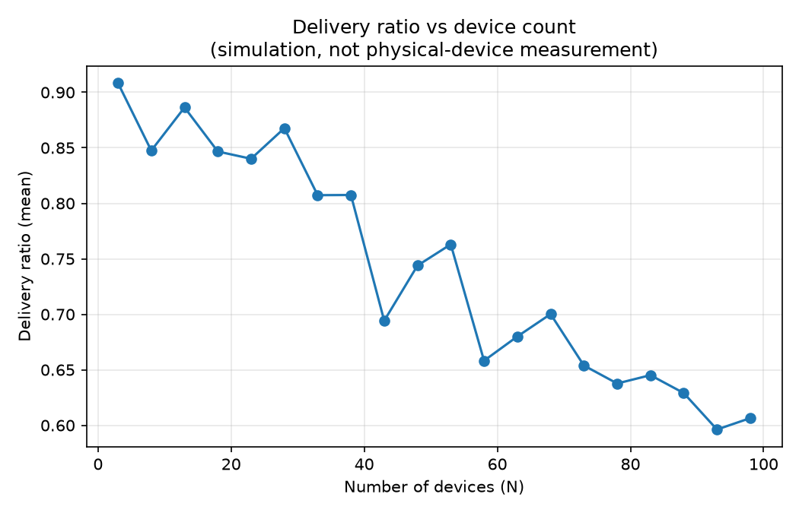
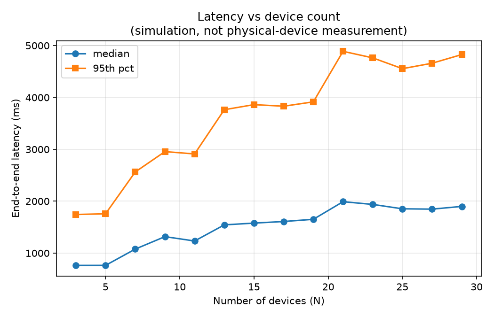
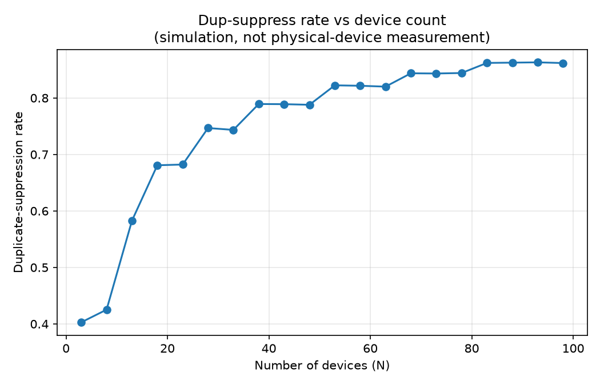
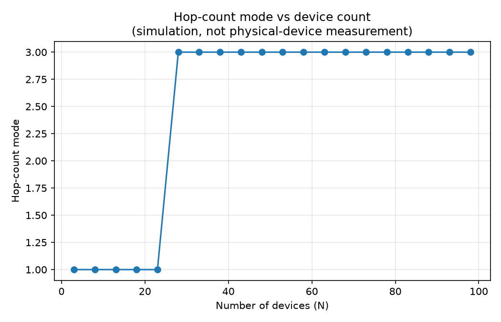

# ble-mesh-eval

A reproducible **simulation** of the SafeSphere BLE flood-relay mesh protocol, built to
evaluate the metrics defined in the paper's Section 7 evaluation protocol:

- delivery ratio
- end-to-end latency (median, 95th percentile)
- hop-count distribution
- duplicate-suppression rate
- battery draw

across the paper's three trial topologies (T1 line, T2 clique, T3 room-scale), and across
a sweep of device counts from 3 to 29.

> **Simulation, not a hardware measurement.** This repo models the protocol's real logic —
> the seen-set deduplication, hop counting, and TTL handling from `BlePacket.kt` /
> `BleMeshManager.kt` in the Android app — and runs it over simulated radio links with
> assumed delivery probability and latency parameters (`sim/protocol.py:LinkModel`).
> Every number below comes from that model. It is a rigorous, labelled way to predict and
> reason about the protocol's behaviour before/alongside physical-device trials, not a
> replacement for them. See `EVALUATION-PROTOCOL.md` in the main app repo for the physical
> trial design these simulations are built to mirror.

---

## 1. Results — T1 / T2 / T3 (200 trials each)

| Metric | T1 line | T2 clique | T3 room-scale |
|---|---|---|---|
| Delivery ratio (mean) | 0.873 | **1.000** | 0.877 |
| Latency median (ms) | 625 | 575 | 780 |
| Latency 95th pct (ms) | 1 323 | 914 | 1 835 |
| Hop-count mode | 1 | 1 | 1 |
| Dup-suppress rate | 0.375 | 0.743 | 0.403 |
| Battery idle (mAh/30 min) | screen-off 0.65 / screen-on 1.30 | — | — |
| Battery active (mAh/30 min) | screen-off 1.01 / screen-on 1.66 | — | — |

Raw output: [`out/table3_simulated.csv`](out/table3_simulated.csv).

**Reading the results.** T2 (a tight 5-device clique) reaches perfect delivery because
every device is within one hop of every other — there's no relay to fail. T1 and T3 sit
a little lower because each depends on a specific relay path (the single middle device in
T1's line, the single bridge device in T3's two cliques) rather than many redundant paths.
T3's 95th-percentile latency (1 835 ms) is the highest of the three, which tracks with it
needing the most hops to fully cross — each extra hop re-pays the full connect + MTU +
write cost, so latency compounds with hop count rather than staying flat.

Dup-suppress rate also follows topology shape directly: it's lowest in the sparse line
(0.375, few redundant paths to produce duplicates) and highest in the dense clique (0.743,
where most devices hear the same packet from several neighbours and all but one copy gets
correctly dropped).

---

## 2. Results — scaling device count (3 → 98 devices, 80 trials per step)

Topology: `scaled_room(n)` — the T3 shape generalised, i.e. bridged cliques whose number
and size both grow with `n` (see `sim/topologies.py`). Number of cliques grows as `√n`, so
a flood crossing the whole mesh needs more bridge-to-bridge hops as `n` grows.

| N | Delivery ratio | Latency median (ms) | Latency 95th pct (ms) | Dup-suppress rate | Hop-count mode |
|---|---|---|---|---|---|
| 3 | 0.908 | 760 | 1 732 | 0.403 | 1 |
| 8 | 0.848 | 1 073 | 2 524 | 0.425 | 1 |
| 13 | 0.886 | 1 551 | 3 574 | 0.583 | 1 |
| 18 | 0.847 | 1 546 | 3 936 | 0.681 | 1 |
| 23 | 0.840 | 1 770 | 4 755 | 0.682 | 1 |
| 28 | 0.868 | 1 850 | 4 530 | 0.747 | **3** |
| 33 | 0.807 | 2 024 | 5 079 | 0.743 | 3 |
| 38 | 0.808 | 2 120 | 5 110 | 0.789 | 3 |
| 43 | 0.694 | 2 142 | 5 049 | 0.789 | 3 |
| 48 | 0.744 | 2 315 | 5 342 | 0.788 | 3 |
| 53 | 0.763 | 2 215 | 4 852 | 0.822 | 3 |
| 58 | 0.658 | 2 056 | 4 870 | 0.822 | 3 |
| 63 | 0.680 | 2 213 | 5 191 | 0.820 | 3 |
| 68 | 0.700 | 2 274 | 5 216 | 0.844 | 3 |
| 73 | 0.654 | 2 420 | 5 240 | 0.843 | 3 |
| 78 | 0.638 | 2 436 | 5 202 | 0.844 | 3 |
| 83 | 0.645 | 2 401 | 5 076 | 0.862 | 3 |
| 88 | 0.629 | 2 331 | 5 164 | 0.863 | 3 |
| 93 | 0.596 | 2 500 | 5 348 | 0.863 | 3 |
| 98 | 0.606 | 2 454 | 5 308 | 0.862 | 3 |

Raw output: [`out/scale_sweep.csv`](out/scale_sweep.csv).









**Trends.**

- **Delivery ratio degrades as the mesh grows past ~30 devices** — it holds near 0.84–0.91
  up to N≈25, then drifts down to roughly 0.60–0.70 by N≈90. At small N there are only a
  couple of cliques and one bridge, so a flood rarely fails to cross; at large N there are
  many cliques chained together, and the flood has to survive every bridge-to-bridge hop in
  sequence — one weak link anywhere in a longer chain is enough to strand an entire distant
  clique, which pulls the mean down. This is the single most important scaling finding:
  **reachability is bridge-chain-length limited, not device-count limited** in this
  topology.
- **Latency roughly triples** from N=3 (median 760 ms) to N≈98 (median ~2 450 ms), and the
  95th percentile grows similarly (1 732 ms → ~5 300 ms), then both roughly plateau past
  N≈50. More cliques means more hops end-to-end, and each hop re-pays a full connect cost,
  so latency compounds with network diameter (number of cliques to cross), not with raw
  device count — the plateau suggests `√n` clique growth caps how much the diameter keeps
  increasing.
- **Dup-suppress rate climbs steadily and keeps climbing**, from 0.40 at N=3 to ~0.86 by
  N≈90 — unlike latency it hasn't plateaued in this range. Larger cliques mean a device
  hears the same flooded packet from more neighbours at once, so an ever-larger share of
  arrivals are correctly-dropped duplicates.
- **Hop-count mode jumps from 1 to 3 once N passes ~25** and stays at 3 for the rest of the
  sweep — past that point most devices are two cliques away from the sender rather than
  one, a clear signature of the flood genuinely spanning a multi-clique structure instead
  of staying local.

---

## 3. What generated these numbers

The simulation reuses the protocol's actual rules, not a simplified stand-in:

- **Seen-set deduplication** — a `LinkedHashSet`-style cap at 500 entries, identical to
  `BleMeshManager.addSeen()`.
- **Hop counting and TTL** — each relay increments hop count and decrements TTL exactly as
  `BlePacket.relayed()` does (`ttl-1, hopCount+1, reachCount+1`).
- **Topologies** — T1 (two edge devices + one relay), T2 (one clique within range), and T3
  (two cliques joined by a single bridge device) are built exactly to the paper's trial
  design in `sim/topologies.py`.

The one modelled (not measured) piece is the radio link itself: each hop has a configurable
delivery probability and a latency distribution (`sim/protocol.py:LinkModel`, currently
92% delivery, ~550 ms mean per hop). These are reasonable placeholder assumptions for BLE
GATT connect + MTU negotiate + write, and the whole point of labelling them is so they can
be swapped for real figures the moment physical trial data exists — at which point every
result in this README can be regenerated from measured inputs instead of assumed ones.

---

## 4. Layout

```
sim/
  protocol.py     # flood-relay simulation core, mirrors BleMeshManager semantics
  topologies.py   # T1 line / T2 clique / T3 bridged-cliques / scalable N-device topology
  metrics.py      # delivery ratio, latency percentiles, hop-count dist, dup-suppress, battery model
run_table3.py     # one fixed run of T1/T2/T3, prints + optional CSV
run_scale_sweep.py# sweeps N devices, writes CSV + PNG graphs to out/
out/              # generated CSVs and graphs (this README's numbers)
```

## 5. Reproducing these results

```bash
python3 -m venv .venv && source .venv/bin/activate
pip install -r requirements.txt

python3 run_table3.py --trials 200 --csv out/table3_simulated.csv
python3 run_scale_sweep.py --min-n 3 --max-n 100 --step 5 --trials 80
```

## 6. Calibrating against physical trials

Once physical-device trials are run, update `LinkModel.delivery_prob`, `latency_mean_ms`,
`latency_sd_ms` in `sim/protocol.py`, and the constants in `metrics.py:BatteryModel`, to
match the measured values, then re-run both scripts. The simulation's shape (how metrics
move with topology and device count) stays useful even after calibration — it's the two
link parameters that get replaced with real numbers.
